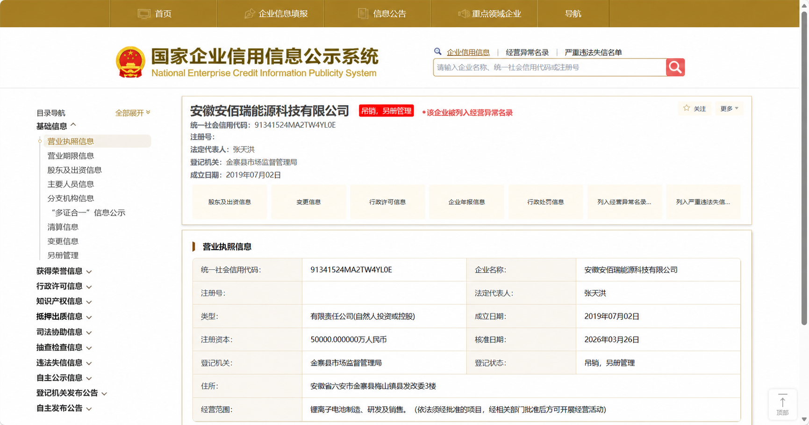

# 企业信息截图助手 GSXT Screenshot Helper

辅助用户在国家企业信用信息公示系统中整理企业名单、核对企业详情并保存当前可见页面的 JPG 截图。当前版本为 **v1.2.2**，适用于 Edge 浏览器扩展。

## 功能

- 导入 TXT/CSV 企业名单，或从当前搜索结果识别候选企业并去重。
- 人工打开、核对企业详情后，保存当前视口截图。
- 记录已完成和失败企业，导出 CSV，并检查截图文件名及重复图片。
- 暂停任务和恢复进度。

扩展不会自动处理登录、验证码或网站限制，也不会自动滚动拼接整页。截图前应人工核对企业名称、统一社会信用代码和营业执照信息。

## 安装

1. 下载本仓库源码，在 Edge 打开 `edge://extensions`。
2. 启用开发人员模式，点击“加载解压缩的扩展”，选择包含 `manifest.json` 的目录。
3. 打开国家企业信用信息公示系统并按官网要求完成登录和验证。
4. 打开扩展弹窗，导入或识别名单，逐家核对并保存 JPG。

详细操作和权限说明见 [使用说明](docs/USAGE.md)。测试范围见 [测试结果](TEST_RESULTS.md)。

## 示例截图

示例以真实企业详情截图为参考，右上角登录账号信息已去除；处理过程可能重绘局部文字，因此图片仅用于展示截图形式，不作为企业登记信息的依据。仓库不包含批量采集的企业截图。

## 隐私与使用范围

扩展记录保存在浏览器本地。提交问题报告时，请先删除企业名单、个人账号信息、下载路径及不希望公开的截图内容。网站页面结构变化可能导致识别失败；本版本在本地模拟页面完成了测试，真实官网使用仍需人工验证。
